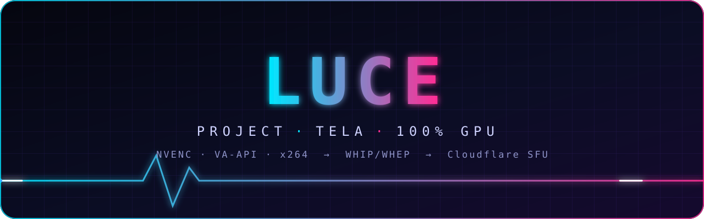
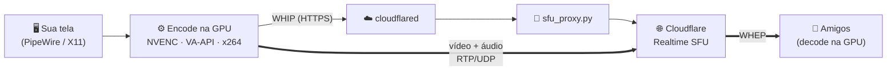

<div align="center">



<br/>


### Divida a sua tela com a galera. Sem Electron, sem travar, sem queimar a CPU.

**Localização Universal Centralizada de Entretenimento** — o *Go Live* que o Linux merecia.

<br/>


**[⚡ Instalar](#-instalar-em-30-segundos)** &nbsp;·&nbsp; **[✨ O que tem](#-o-que-tem-aqui)** &nbsp;·&nbsp; **[🛰️ Como funciona](#️-como-funciona)** &nbsp;·&nbsp; **[🧪 Rodar do código](#-rodando-do-código)** &nbsp;·&nbsp; **[🏗️ Servidor](#️-servidor-sua-própria-nuvem)**

</div>

---

## 🤔 Por que isso existe?

O Go Live (Electron) no Linux **codifica a tela na CPU**, mesmo com uma RTX na máquina. E, por ser *mesh*, quem transmite sobe um vídeo **por espectador**: com meia dúzia de amigos assistindo, a sua internet vira o gargalo.

O LUCE resolve os dois lados:

| | Go Live (Electron) | **Project LUCE** |
|---|---|---|
| Encode da tela | CPU, sempre | **GPU** (NVENC / VA-API), CPU só como último recurso |
| Upload com N espectadores | N × o vídeo | **1 × o vídeo** (o SFU distribui) |
| Cliente | Electron | **Nativo**: Python + GTK4 + GStreamer |
| Instalação | AppImage solto | **Flatpak** com atualização automática |
| Servidor | de terceiros | **o seu**, sem abrir porta no roteador |

---

## ⚡ Instalar em 30 segundos

```bash
flatpak install --user https://codestage-pro.github.io/project-luce/luce.flatpakref
```

Pronto. O ícone **Project LUCE** aparece no menu de apps e as atualizações chegam sozinhas pelo **GNOME Software**, pelo **Discover** ou por `flatpak update`. Não precisa configurar servidor: o Flatpak já vem apontando para o do grupo — só digite o **nome** e a **senha do grupo** na primeira abertura.

> 💡 Sem o Flatpak instalado? Veja o [guia oficial](https://flatpak.org/setup/) (uma linha na maioria das distros).

<details>
<summary><b>🏹 Prefere Arch (PKGBUILD)?</b></summary>

```bash
sudo pacman -S --needed base-devel
git clone https://github.com/Codestage-pro/project-luce.git
cd project-luce
makepkg -si          # ou: paru -Bi .   (o ponto é obrigatório)
```

**Não é pacote da AUR**: `-si` / `-B` só buildam o `PKGBUILD` da pasta clonada. Isso instala as dependências, o pacote `luce/` em `/usr/share/project-luce`, o lançador `luce` em `/usr/bin` e o ícone no menu.

</details>

### 🎮 Placa de vídeo

O LUCE escolhe sozinho, nesta ordem:

| Prioridade | Encoder | Quando | Aparece na janela como |
|:--:|---|---|---|
| 1 | `nvh264enc` | NVIDIA (driver proprietário) | `NVENC, GPU` |
| 2 | `vah264enc` / `vah264lpenc` | AMD / Intel com driver VA-API | `VA-API, GPU` |
| 3 | `x264enc` | nada de GPU disponível | `x264, CPU` |

Para decodificar (assistir): `nvh264dec` → `vah264dec` → `avdec_h264`.

> ⚠️ **Honestidade técnica:** NVIDIA está testada de ponta a ponta. O caminho **VA-API (AMD/Intel) ainda não foi validado em hardware real**. Tem AMD ou Intel? Rode `flatpak run --command=luce pro.codestage.Luce doctor` e conte pra gente o que apareceu.

Fora do Flatpak, quem não tem NVIDIA precisa de um driver VA-API: `intel-media-driver` (Intel Broadwell+), `libva-mesa-driver` (AMD) ou `libva-intel-driver` (Intel até Haswell). No Flatpak, o runtime já traz o driver Mesa e baixa o da Intel sozinho.

---

## ✨ O que tem aqui

- 🖥️ **Transmitir a tela** com um clique — pelo portal do sistema, escolhendo o monitor (Wayland) ou direto pelo X11
- 👀 **Assistir** quem está no ar, com **vários streams ao mesmo tempo** no visualizador
- 🔊 **Áudio Opus** com mute e volume **por pessoa**
- 📊 **Estatísticas ao vivo** da transmissão (pacotes, bitrate e perda, de quem transmite e de cada transmissão que você assiste)
- 🎛️ **Configurações em botões** (resolução, fps, qualidade) — nada de digitar um valor que o encoder ou a rede não aguentam
- 🛟 **Recuperação de perda**: NACK + RTX, GOP de 1 s e VBV controlado para a imagem voltar rápido
- 🔁 **Reconexão automática** quando a tela é trocada ou a conexão cai
- 🔄 **Atualização automática** via Flatpak assinado com GPG
- 🧰 **CLI completa** para quem gosta de terminal

```text
luce gui            # abre a janela
luce share --path nome
luce watch  nome
luce doctor         # testa encoder e elementos GStreamer
```

---

## 🛰️ Como funciona



O **vídeo vai direto do cliente para o IP anycast da Cloudflare**; o servidor só fala HTTP. Por isso **não existe porta UDP para abrir no roteador, nem VPN**, e o `CF_SFU_APP_SECRET` nunca sai do servidor.

**Quem está no ar:** o servidor registra quem fez `POST /{nome}/whip` e tira da lista no `DELETE`. Se a pessoa cair sem avisar, sai 30 s depois do último heartbeat (o cliente manda um `PATCH` a cada 10 s). O estado fica só em memória.

### 🖼️ O seletor de tela depende do ambiente

O `xdg-desktop-portal` sozinho não captura nada — quem captura é o backend do ambiente: **GNOME** (`-gnome`), **KDE** (`-kde`), **wlroots/sway** (`-wlr`) e **Hyprland** (`-hyprland`). XFCE, Cinnamon, i3 e afins costumam ter só o `-gtk`, que **não** captura.

O app detecta isso ao clicar em *Transmitir*: em **X11 de verdade** captura a tela direto (`ximagesrc`, sem seletor); em **Wayland sem backend** não há saída, e a janela diz qual pacote instalar.

---

## 🧪 Rodando do código

Requisitos (Arch): `gst-plugin-webrtchttp` (dá `whipsink`/`whepsrc`), `gst-plugins-bad` com `nvcodec` (dá `nvh264enc`/`nvh264dec`) e `gst-plugins-base` com OpenGL.

```bash
python -m luce doctor            # testa NVENC/NVDEC sem precisar de servidor
python -m luce gui               # janela GTK4
python -m luce share --path test --pattern   # padrão de teste, sem seletor de monitor
python -m luce watch test        # em outro terminal
python -m unittest discover -s server        # testes do servidor (SFU falso, sem rede)
```

A configuração do cliente fica em `project-luce/config.toml` dentro do `XDG_CONFIG_HOME` — no Flatpak, `~/.var/app/pro.codestage.Luce/config/`; fora dele, `~/.config/`.

```toml
base_url = "http://127.0.0.1:8889"   # padrão para rodar tudo local
auth_password = "<BDK_PASSWORD>"
```

---

## 🏗️ Servidor: sua própria nuvem

Roda numa máquina qualquer (aqui, um notebook Debian com Dokploy). A sinalização passa pelo `cloudflared`; a mídia vai do cliente direto pro Cloudflare.

1. **Cloudflare** → Realtime → SFU → crie um app e copie o *App ID* e o *App Secret*.
2. **Dokploy** → `server/docker-compose.yml` como *Docker Compose*, **sem domínio configurado nele** (o acesso é só pelo túnel). Na aba *Environment* coloque `CF_SFU_APP_ID`, `CF_SFU_APP_SECRET` e `BDK_PASSWORD`. A porta 8889 só é publicada em `127.0.0.1`.
3. **Túnel** — no `/etc/cloudflared/config.yml`, antes da regra catch-all:
   ```yaml
   - hostname: luce.codestage.pro
     service: http://127.0.0.1:8889
   ```
   depois `cloudflared tunnel route dns <tunnel> luce.codestage.pro` e reinicie o `cloudflared`.
4. Toda rota exige `Authorization: Bearer bdk:<BDK_PASSWORD>`; o mesmo valor vai em `auth_password` no `config.toml` de quem usa.

Para rodar local: `cp server/.env.example server/.env`, preencha, e `python server/sfu_proxy.py` (só biblioteca padrão).

---

## 🔬 Pegadinhas que custaram caro

<details>
<summary><b>WebRTC / SFU (`gst-plugin-webrtchttp`)</b></summary>

- O `whepsrc` **sempre oferece um m-line de áudio**, então o publisher sempre manda uma faixa de áudio — muda (via `volume`) quando "transmitir áudio" está desligado.
- O offer do `whepsrc` **não é aceito como está pelo SFU**: ele oferece `OPUS/48000` sem o `/2` de canais e VP8/VP9/H265/AV1 além do H264; com qualquer um deles o SFU recusa tudo com *"missing the published track's codec"*. O proxy corrige o Opus, deixa só o H264 e põe os `rtx` na frente (o SFU só responde ao último payload type) — veja `whep_offer` em `server/sfu_proxy.py`.
- O WHEP do SFU só funciona se o publisher **já estiver com o ICE conectado**; o proxy tenta de novo (6×, 1,5 s) ao receber `not_found_track_error`.
- O `pad-added` do `whepsrc` dispara **antes das caps negociarem** e os pads têm nome genérico (`src_%u`): plugamos um `parsebin` em cada pad novo e olhamos a caps resultante (`audio/x-opus` ou `video/x-h264`) para montar a cadeia certa (`luce/watch_pipeline.py:_on_pad_added`).

</details>

<details>
<summary><b>GPU / OpenGL</b></summary>

- A interface GTK e o preview rodam em **Vulkan**; a captura com NVENC usa **OpenGL de propósito** (`nvh264enc` só aceita `GLMemory` ou `CUDAMemory`; o GStreamer não tem entrada Vulkan para ele).
- **Um `gtk4paintablesink` no mesmo pipeline do `glupload` derruba a 2ª transmissão** com `EGL_BAD_CONTEXT`. Por isso o preview roda num pipeline próprio, ligado por `appsink`/`appsrc` (`CapturePipeline._preview_bridge`).
- O `gst-va` rejeita o driver VA da NVIDIA ("Unsupported driver"); no Flatpak o `LIBVA_DRIVER_NAME=nvidia` só vale em hosts NVIDIA.

</details>

<details>
<summary><b>Áudio</b></summary>

O publisher sempre manda uma faixa Opus (`pulsesrc` → funciona em PulseAudio e em PipeWire via `pipewire-pulse`). Ela aparece como **"Project LUCE"** no `qpwgraph`/`pavucontrol` para quem quiser rotear manualmente.

</details>

---

## 📦 Como os updates chegam (para quem mantém)

Marcar uma tag `vX.Y.Z` dispara o GitHub Actions: ele builda o Flatpak, **assina o repositório OSTree com GPG** e publica no GitHub Pages. Quem instalou pelo `.flatpakref` recebe a versão nova no próximo `flatpak update`.

```bash
git tag v1.0.12 && git push origin main v1.0.12
```

---

## ⚖️ Licença

**Todos os direitos reservados © 2026 Codestage.pro.** O código está público para consulta e para distribuir o app pelos canais oficiais, mas **não é open source**: copiar, modificar, redistribuir ou vender qualquer parte dele exige autorização por escrito. Detalhes no arquivo [`LICENSE`](LICENSE).

---

## 🗺️ Fora de escopo (por enquanto)

- Windows e macOS
- Qualidade adaptada por espectador (o SFU suporta *simulcast*, mas o cliente publica uma qualidade só)

<div align="center">

<br/>

**Feito com ☕, GStreamer e muita teimosia pela Codestage.pro** · app ID `pro.codestage.Luce`

</div>
